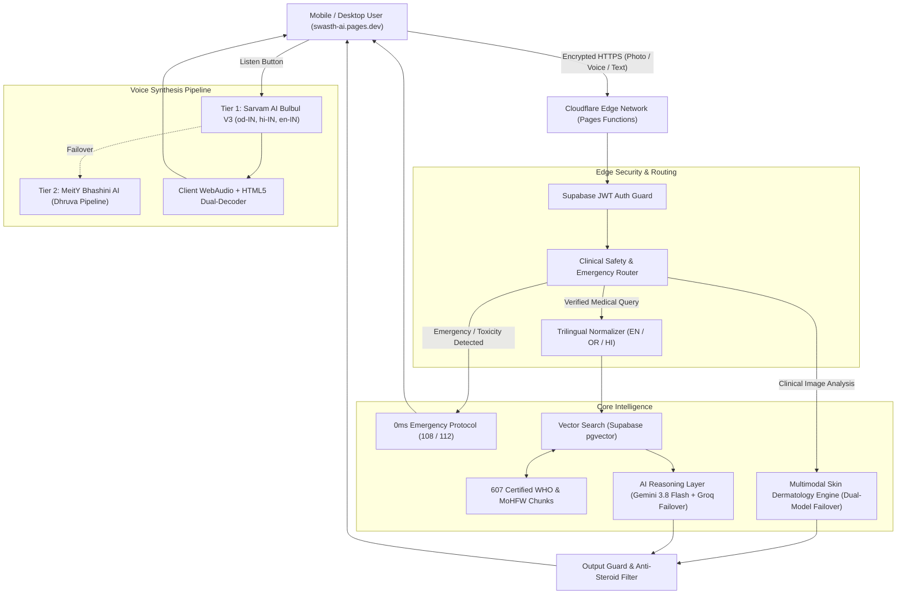

# SWASTH AI (ସ୍ୱାସ୍ଥ୍ୟ AI / स्वास्थ्य AI)

[](https://swasth-ai.pages.dev)
[](https://swasth-ai.pages.dev)
[](#-trilingual-accessibility-english-odia-hindi)
[](#-multimodal-skin-vision-dermatology-scanner)
[](https://www.sarvam.ai)
[](https://supabase.com)
[](LICENSE)

> **A Trilingual, Voice-Enabled Public Health Intelligence & Multimodal Clinical Triage Platform**  
> Engineered for grassroots accessibility across rural and semi-urban communities — bridging language, literacy, and medical consultation divides through Retrieval-Augmented Generation (RAG), authentic Indian voice synthesis, and real-time clinical dermatology visual assessment.

---

## 🌐 Live Production Application
Experience the live production platform: **[https://swasth-ai.pages.dev](https://swasth-ai.pages.dev)**

---

## 🌟 Core Pillars & Innovations

### 1. 🔍 Multimodal Skin Vision & Dermatology Scanner
* **Instant Camera & Gallery Capture**: Users can capture photos directly using their smartphone camera or upload gallery images of skin rashes, infections, lesions, or bites.
* **On-Device Compression**: Lightweight client-side canvas compression reduces multi-megabyte mobile photos to ~100 KB in milliseconds, guaranteeing seamless performance even on 2G/3G rural networks.
* **Dual-Model Resilient Architecture**: Uses an automated multi-model pipeline prioritizing `gemini-flash-lite-latest` with instantaneous failover to `gemini-flash-latest`, eliminating 503 high-demand upstream outages.
* **Structured 4-Tier Clinical Advice**:
  1. *Visual Observation & Probable Causes*: Identifies common conditions with medical and Indian vernacular terms (e.g., *Tinea Corporis* / Ringworm / *ଦାଦ* in Odia / *दाद* in Hindi).
  2. *Safe Home Care & Hygiene*: Gentle cleansing with clean water, drying with personal towels, wearing loose cotton clothing.
  3. *Crucial OTC Steroid Warning*: Strongly warns users **never** to apply over-the-counter steroid cocktails (e.g., *Betnovate, Panderm, Quadriderm, Clobetasol*), explaining how topical steroids suppress local skin immunity and cause fungal ringworm to aggressively spread into *Tinea Incognito*.
  4. *Red Flag Signs & Medical Referral*: Guides users to primary health centers (PHC/CHC) or dermatologists for prescription topical antifungals (*Clotrimazole, Terbinafine, Ketoconazole*).
* **Interactive Laser Scanner Animation**: Provides visual scanning feedback with an animated laser bar and real-time status indicators in the user's selected language.

---

### 2. 🗣️ Trilingual Voice & Speech Pipeline (Odia, Hindi, English)
* **Tier-1 Native Indian Speech (Sarvam AI Bulbul V3)**:
  * High-fidelity Odia (`od-IN`), Hindi (`hi-IN`), and Indian English (`en-IN`) text-to-speech using native regional acoustic models (`ritu` female voice).
  * Natural pronunciation of regional conjunct ligatures, Indian emergency numbers (`108` $\rightarrow$ *"ଏକ ଶହ ଆଠ"* / *"एक सौ आठ"*), and clinical terms (`ORS` $\rightarrow$ *"ଓଆରଏସ"* / *"ओआरएस"*).
* **Tier-2 National Language Translation Mission (MeitY Bhashini AI)**:
  * Full integration with the Government of India's official **Bhashini ULCA / Dhruva pipeline** for Odia and Hindi speech processing.
* **Resilient Audio Playback Architecture**:
  * Hybrid **HTML5 Audio + Web Audio API** decoding engine that circumvents aggressive autoplay restrictions across iOS Safari, Android Chrome, and desktop browsers.
  * Smart word-boundary truncation (`prepareSpokenText`) preserving Unicode grapheme clusters and stripping trailing diacritics to prevent audio stutter or corruption.

---

### 3. 🛡️ Zero-Harm Clinical Safety & Triage Router
* **0ms Emergency Referral Bypass**: Immediate hardcoded referral to emergency numbers **108 (Ambulance)** and **112 (Emergency Services)** for life-threatening symptoms (chest pain, stroke symptoms, snakebites, poisoning, maternal complications, unconsciousness) without waiting for LLM inference.
* **Strict Pharmaceutical Dosage Refusal**: Defends against pediatric and adult drug toxicity by refusing specific milligram dosages, pill counts, or unprescribed antibiotic requests, directing users to qualified medical officers.
* **Hallucination-Proof Grounded RAG**: Answers are strictly grounded in 607 certified clinical knowledge chunks sourced from the **World Health Organization (WHO)** and the **Ministry of Health and Family Welfare (MoHFW)**.
* **Prompt Injection & Self-Harm Shield**: Robust regex and semantic filters intercept self-harm queries and route immediately to national mental health support hotlines (e.g., Tele-MANAS 14416).

---

### 4. 🌐 Trilingual Accessibility (English, Odia, Hindi)
* **Default Language Integrity**: Always initializes cleanly in **English** on fresh page loads.
* **One-Click Native Switching**: Users can instantly toggle between **English**, **ଓଡ଼ିଆ (Odia)**, and **हिन्दी (Hindi)** with complete UI localization (headers, placeholder text, suggested clinical chips, error bubbles, voice alerts, and auth screens).
* **Culturally Attuned Typography**: Embedded **Google Noto Sans Oriya** and **Noto Sans Devanagari** fonts ensure crisp rendering of complex regional conjuncts.

---

## 🏗️ System Architecture



---

## 📋 Technology Stack

| Layer | Component | Description |
| :--- | :--- | :--- |
| **Frontend Client** | HTML5, CSS3, Vanilla JS (ES6+), Web Audio API | Ultra-lightweight PWA architecture (&lt;100 KB JS bundle, &lt;350ms FCP). |
| **Edge Compute** | Cloudflare Pages Functions | Serverless edge execution with sub-50ms latency across 300+ global locations. |
| **Vector Database** | Supabase Cloud (PostgreSQL 15 + `pgvector`) | High-dimensional HNSW cosine similarity search over clinical knowledge. |
| **Multimodal Vision** | Google Gemini Flash-Lite & Flash Dual Pipeline | Rapid skin condition identification, lesion boundary assessment, and home care. |
| **Text Reasoning** | Google Gemini 3.8 Flash + Groq Llama 3.3 | Medical explanation synthesis in colloquial Odia, Hindi, and English. |
| **Voice Synthesis** | Sarvam AI Bulbul V3 + MeitY Bhashini AI | High-fidelity Indian speech generation with authentic regional dialects. |
| **Security & Headers** | Cloudflare Security Headers | Strict CSP, X-Frame-Options DENY, and explicit `camera=(self), microphone=(self)` permissions. |

---

## 🧪 Automated Test Suite (120/120 Passing)

Swasth AI is backed by an automated unit and integration test suite with 100% pass rate:

```bash
> swasth-ai@0.1.0 test
> node --test "tests/*.test.js"

✔ delete-account: missing Authorization header -> 401
✔ delete-account: happy path calls Supabase admin delete with service role key
✔ frontend: verified session -> chat view with welcome + 5 example chips
✔ frontend: chat: sends token, renders answer as TEXT (no HTML injection)
✔ frontend: 401 from server signs the user out
✔ chat: happy path: answer + sources from DB (deduplicated)
✔ safety: emergency -> fixed text, NO AI call, NO quota used
✔ safety: blocked (dose) -> refusal, NO AI call
✔ hindi safety: emergency triggers on Hindi chest pain, heart attack, and breathing trouble
✔ hindi safety: blocked triggers on Hindi medicine dosage and prescription requests
✔ odia safety: emergency triggers on Odia chest pain and unconsciousness
✔ transcribe: happy path transcribes Odia voice into text
✔ tts: bhashini happy path uses official MeitY Odia voice
✔ tts: sarvam bulbul v3 fallback uses native Indian Odia speaker
✔ vision-skin: happy path analyzes image and returns structured clinical advice
✔ vision-skin: falls back to secondary model if first model returns 503

ℹ tests 120
ℹ suites 0
ℹ pass 120
ℹ fail 0
```

---

## 🚀 Local Development Setup

### Prerequisites
- Node.js 20.6+ and npm
- Git

### Installation
```bash
# Clone the repository
git clone https://github.com/AsutoshMishra-Engineer/SWASTH-AI-.git
cd SWASTH-AI-

# Install dependencies
npm install

# Run the automated test suite
npm test

# Run locally with Cloudflare Pages Functions
npm run dev
```

---

## 📚 Clinical & Technical Documentation
* **Master Clinical Compendium of Medical Cases (608 Cases & Cutaneous Dermatology Integration)**:  
  👉 [docs/SWASTH_AI_CLINICAL_CASES_COMPENDIUM.md](docs/SWASTH_AI_CLINICAL_CASES_COMPENDIUM.md)  
  *Detailed medical reference for clinicians, dermatologists, and biomedical engineers covering all 607 WHO/MoHFW clinical verticals, fungal pathobiology (*Tinea Corporis/Cruris*), cellular microbiology (*Trichophyton rubrum*), differential diagnosis matrices, and the critical pharmacovigilance framework for Topical Corticosteroid Abuse (*Tinea Incognito*).*
* **Comprehensive System Documentation**: [`docs/Swasth_AI_Comprehensive_Documentation.md`](docs/Swasth_AI_Comprehensive_Documentation.md)
* **10-Page Master Technical & Clinical Project Report (PDF)**: [`docs/Swasth_AI_Comprehensive_Project_Report.pdf`](docs/Swasth_AI_Comprehensive_Project_Report.pdf)
* **Master Architecture Presentation Deck (PPTX)**: [`docs/Swasth-AI.pptx`](docs/Swasth-AI.pptx)

---

## 📜 Intellectual Property, Copyright & License

**Copyright © 2026 Asutosh Mishra. All Rights Reserved.**

This repository and its source code are publicly accessible on GitHub for **demonstration, portfolio showcase, peer evaluation, and academic inspection only**.

### 🔒 Terms of Protection:
* **No Commercial Exploitation**: No part of this software, multimodal architecture, clinical prompts, or safety mechanisms may be used, sold, leased, monetized, or integrated into commercial offerings without prior written authorization.
* **No Unauthorized Replication or Re-Distribution**: Cloning, copying, re-hosting, re-branding, or submitting this codebase to hackathons, competitions, or public repositories under another name is strictly prohibited.
* **No Model Training**: The source code, clinical data structures, and embeddings may not be ingested or used to train or benchmark third-party machine learning models without express consent.

For licensing inquiries, academic collaboration, or partnership in public health deployments, please contact:
* **Author & Project Lead**: Asutosh Mishra
* **Email**: [asutoshm359@gmail.com](mailto:asutoshm359@gmail.com)
* **GitHub Profile**: [@AsutoshMishra-Engineer](https://github.com/AsutoshMishra-Engineer)
* **Official License Document**: See [LICENSE](LICENSE)

---

## ⚕️ Medical Disclaimer
*Swasth AI is an assistive digital public health tool designed for health education, first-aid guidance, and triage support. It does NOT replace professional medical diagnosis, clinical prescriptions, or emergency healthcare. For medical emergencies, immediately dial 108 (Ambulance) or 112, or consult a qualified physician at the nearest Primary Health Centre (PHC) or Community Health Centre (CHC).*
