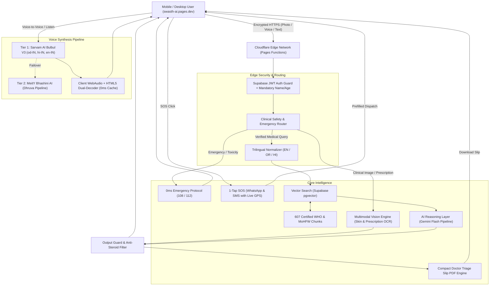

# SWASTH AI (ସ୍ୱାସ୍ଥ୍ୟ AI / स्वास्थ्य AI)

[](https://swasth-ai.pages.dev)
[-success?style=for-the-badge&logo=android)](https://swasth-ai.pages.dev)
[](https://swasth-ai.pages.dev)
[](#-trilingual-accessibility-english-odia-hindi)
[](#-multimodal-clinical-vision-dermatology--prescription-ocr)
[](https://www.sarvam.ai)
[](https://supabase.com)
[](LICENSE)

> **A Trilingual, Voice-Enabled Public Health Intelligence & Multimodal Clinical Triage Platform**  
> Engineered for grassroots accessibility across rural, tribal, and semi-urban communities — bridging language, literacy, and medical consultation divides through Retrieval-Augmented Generation (RAG), authentic Indian voice synthesis, real-time clinical vision analysis, prescription OCR explanation, and 1-tap SOS emergency dispatch.

---

## 📲 Install & Download Swasth AI Mobile App (PWA & Android Lite)

Anyone can immediately download and install the **Swasth AI Mobile Application** onto their smartphone or computer in **5 seconds** without needing the Google Play Store or heavy 100+ MB downloads:

### 🚀 Direct App Installation Link:
👉 **[https://swasth-ai.pages.dev](https://swasth-ai.pages.dev)**

### 📱 Quick 3-Step Installation Guide for Everyone:

* **Android Smartphone Users (Chrome / Edge / Samsung Internet)**:
  1. Open **[https://swasth-ai.pages.dev](https://swasth-ai.pages.dev)** on your Android phone.
  2. Tap the **📲 "Install App"** button in the top navigation bar (or tap the **3 dots (⋮) ➔ "Install app" / "Add to Home screen"**).
  3. Tap **Install** — Swasth AI is now installed on your phone home screen just like *Instagram Lite*!
  4. Launch the app from your home screen: It runs **full-screen with zero browser address bars**, instant camera capture, and offline speed.

* **Apple iPhone / iPad Users (Safari)**:
  1. Open **[https://swasth-ai.pages.dev](https://swasth-ai.pages.dev)** in Safari.
  2. Tap the **Share button (⎋ with arrow)** at the bottom of the screen.
  3. Scroll down and tap **"Add to Home Screen" ➔ Add**.
  4. The standalone Swasth AI app icon will appear directly on your iOS home screen!

* **Desktop / Laptop Users (Windows / Mac / Linux - Chrome & Edge)**:
  1. Open **[https://swasth-ai.pages.dev](https://swasth-ai.pages.dev)**.
  2. Click the **Install icon (🖥️)** in the browser's address bar to install it as a lightweight standalone desktop desktop app.

---

## 🌐 Live Production Application
Experience the live production platform: **[https://swasth-ai.pages.dev](https://swasth-ai.pages.dev)**

---

## 🌟 Core Pillars & Innovations

### 1. 🔍 Multimodal Clinical Vision: Dermatology & Prescription OCR
* **Doctor Prescription & Lab Test Report Explainer (Vision OCR)**:
  * Users can snap photos of handwritten doctor prescriptions, pharmacy slips, or diagnostic lab reports (CBC, lipid profile, urine routine, LFT, KFT).
  * Gemini multimodal OCR extracts medicine names, dosages, frequencies, and lab markers, explaining normal vs. abnormal flags in clear, layman terms in Odia, Hindi, or English.
  * Strict anti-self-medication guard ensures patients never modify dosages without consulting their treating doctor.
* **Clinical Dermatology & Wound Scanner**:
  * Captures photos directly using smartphone camera or gallery for rashes, fungal infections (*Tinea Corporis* / *ଦାଦ* / *दाद*), burns, insect bites, and lesions.
  * Client-side canvas compression reduces multi-megabyte photos to ~100 KB in milliseconds for instant upload on 2G/3G rural networks.
  * **Crucial Anti-Steroid Pharmacovigilance**: Warns patients against applying harmful OTC steroid cocktail creams (e.g., *Betnovate, Panderm, Quadriderm, Clobetasol*) that worsen fungal infections into *Tinea Incognito*.
  * Multi-model failover pipeline prioritizing `gemini-flash-lite-latest` with instantaneous fallback to `gemini-3.5-flash` and `gemini-3.5-flash-lite`.

---

### 2. 🎙️ 100% Hands-Free Voice-to-Voice Mode (Rural & Illiterate Accessibility)
* **Zero-Touch Continuous Voice Interaction**:
  * Designed specifically for elderly, vision-impaired, or illiterate rural users who cannot read or type on mobile keyboards.
  * Real-time automated turn-taking with live visual speech indicators (`Listening...` ➔ `Thinking...` ➔ `Speaking...`).
* **High-Speed Indian Speech Pipeline**:
  * Sub-2-second voice synthesis powered by **Sarvam AI Bulbul V3** (`ritu` Odia and Hindi female acoustic model) and Government of India's **MeitY Bhashini AI**.
  * **0ms Cached Replay**: In-memory audio caching delivers instant zero-latency speech playback on repeat clicks.
  * Correct pronunciation of Indian numerals (`108` $\rightarrow$ *"ଏକ ଶହ ଆଠ"* / *"एक सौ आठ"*), regional terms, and clinical abbreviations (`ORS` $\rightarrow$ *"ଓଆରଏସ"*).

---

### 3. 🚨 1-Tap SOS Emergency Ambulance Dispatch (SMS & WhatsApp with GPS)
* **Instant GPS Emergency Dispatch**:
  * With a single tap on the **🚨 1-Tap SOS** button, the app captures real-time high-accuracy geolocation coordinates.
  * Generates prefilled, one-click emergency dispatch links for both **WhatsApp** and **SMS**, enabling families to instantly notify emergency contacts and local ambulance services with precise map links.
* **0ms Hardcoded Referral Bypass**:
  * Life-threatening queries (chest pain, stroke symptoms, unconsciousness, heavy maternal bleeding, snakebites, poisoning) bypass AI inference completely to display instant emergency contact cards for **108 (Ambulance)** and **112 (Emergency Services)**.

---

### 4. 📄 Doctor Triage Slip PDF Generator
* **Physical Consultation Companion**:
  * Generates an official, compact (<50 KB) **Doctor Triage Slip PDF** formatted for immediate review by Medical Officers at Primary Health Centres (PHC) and Community Health Centres (CHC).
  * Mandatory patient demographics (**Name** and **Age**) collected securely in the profile and printed prominently on the slip.
  * Includes chief complaints, preliminary AI visual observation, vital indicators, verified nearest District Headquarters Hospital (DHH), national helpline numbers, and bilingual clinical disclaimers.

---

### 5. 🏥 Interactive Hospital Finder & Offline Emergency Protocols
* **Interactive District Hospital Locator**:
  * Embedded OpenStreetMap & Leaflet mapping engine pinpointing nearby government hospitals, Community Health Centres (CHCs), and Primary Health Centres (PHCs).
* **10 Certified Rural Offline Emergency Protocols**:
  * Works with **0 KB internet** (offline PWA cache) for life-critical first-aid scenarios:
    1. Snakebite Management (*Do NOT tie tight tourniquets or cut skin*)
    2. Adult & Child CPR (Cardiopulmonary Resuscitation)
    3. Severe Bleeding & Wound Pressure
    4. Choking (Heimlich Maneuver)
    5. Heatstroke & Severe Dehydration
    6. Burn Wound Care & Cooling
    7. Poisoning & Chemical Ingestion
    8. Seizures & Convulsions Safety
    9. Unconsciousness & Recovery Position
    10. Maternal Warning Signs & Labour Transport

---

### 6. 🌐 Trilingual Accessibility (English, Odia, Hindi)
* **One-Click Native Switching**:
  * Instant toggling between **English**, **ଓଡ଼ିଆ (Odia)**, and **हिन्दी (Hindi)** with full UI localization.
  * High-fidelity typographic rendering through Google's **Noto Sans Oriya** and **Noto Sans Devanagari** fonts for complex conjuncts.
  * Strict language routing ensures Odia queries always receive pure Odia guidance, disclaimers, and audio.

---

## 🏗️ System Architecture



---

## 📋 Technology Stack

| Layer | Component | Description |
| :--- | :--- | :--- |
| **Frontend Client** | HTML5, CSS3, Vanilla JS (ES6+), Web Audio API | Ultra-lightweight PWA architecture (&lt;100 KB JS bundle, &lt;350ms FCP, offline PWA cache). |
| **Edge Compute** | Cloudflare Pages Functions | Serverless edge execution with sub-50ms latency across 300+ global edge nodes. |
| **Vector Database** | Supabase Cloud (PostgreSQL 15 + `pgvector`) | High-dimensional HNSW cosine similarity search over certified medical knowledge. |
| **Multimodal Vision** | Google Gemini Flash-Lite & Flash Pipeline | High-speed dermatology rash analysis and doctor prescription/lab test OCR. |
| **Text Reasoning** | Google Gemini 3.5 Flash + Flash-Lite | Clinical explanation synthesis in colloquial Odia, Hindi, and English. |
| **Voice Synthesis** | Sarvam AI Bulbul V3 + MeitY Bhashini AI | High-fidelity Indian speech generation with authentic regional dialects and 0ms cache. |
| **Maps & Location** | Leaflet.js + OpenStreetMap | Interactive hospital and healthcare facility finder with GPS routing. |
| **Document Generation** | On-device Compact PDF Engine | Generates official Doctor Triage Slip PDFs (&lt;50 KB) without external libraries. |
| **Security & Headers** | Cloudflare Security Headers | Strict CSP, X-Frame-Options DENY, and explicit `camera=(self), microphone=(self), geolocation=(self)` permissions. |

---

## 🧪 Automated Test Suite (142/142 Passing)

Swasth AI is verified by an automated unit, integration, and safety test suite with a 100% pass rate:

```bash
> swasth-ai@0.1.0 test
> node --test "tests/*.test.js"

✔ delete-account: missing Authorization header -> 401
✔ delete-account: happy path calls Supabase admin delete with service role key
✔ frontend: verified session -> chat view with welcome + 5 example chips
✔ frontend: guest mode card allows asking questions without login
✔ frontend: sign-up validates name, age, email and password
✔ frontend: existing verified session without name/age prompts mandatory profile modal
✔ frontend: chat: sends token, renders answer as TEXT (no HTML injection)
✔ frontend: chat: network error renders retry bar and allows 1-tap re-send
✔ frontend: hands-free voice call button toggles active call state and shows live banner
✔ frontend: 1-tap SOS emergency button opens emergency modal with GPS and dispatch
✔ frontend: prescription and lab report action box binds file input and sets triage mode
✔ safety: emergency -> fixed text, NO AI call, NO quota used
✔ safety: blocked (dose) -> refusal, NO AI call
✔ hindi safety: emergency triggers on Hindi chest pain, heart attack, and breathing trouble
✔ hindi safety: blocked triggers on Hindi medicine dosage and prescription requests
✔ odia safety: emergency triggers on Odia chest pain and unconsciousness
✔ odia safety: blocked triggers on Odia medicine dosage request
✔ offline protocols: exactly 10 emergency protocols defined with trilingual content
✔ pdf generator: wrapJpegInPdf produces valid, compact PDF under 50 KB
✔ transcribe: happy path transcribes Odia voice into text
✔ tts: bhashini happy path uses official MeitY Odia voice
✔ tts: sarvam bulbul v3 fallback uses native Indian Odia speaker
✔ tts: lang=or strictly prioritizes Odia even with mixed script
✔ vision-report: happy path analyzes prescription or lab report and returns structured advice
✔ vision-skin: happy path analyzes image and returns structured clinical advice
✔ vision-skin: falls back to secondary model if first model returns 503

ℹ tests 142
ℹ suites 0
ℹ pass 142
ℹ fail 0
```

---

## 🚀 Local Development Setup

### Prerequisites
- Node.js 20.6+ and npm
- Git

### Installation
```bash
# Clone the repository
git clone https://github.com/AsutoshMishra-Engineer/SWASTH-AI-.git
cd SWASTH-AI-

# Install dependencies
npm install

# Run the automated test suite (142 tests)
npm test

# Run locally with Cloudflare Pages Functions
npm run dev
```

---

## 📚 Clinical & Technical Documentation
* **Master Clinical Compendium of Medical Cases (608 Cases & Cutaneous Dermatology Integration)**:  
  👉 [docs/SWASTH_AI_CLINICAL_CASES_COMPENDIUM.md](docs/SWASTH_AI_CLINICAL_CASES_COMPENDIUM.md)  
  *Detailed medical reference for clinicians, dermatologists, and biomedical engineers covering all 607 WHO/MoHFW clinical verticals, fungal pathobiology (*Tinea Corporis/Cruris*), cellular microbiology (*Trichophyton rubrum*), differential diagnosis matrices, and the critical pharmacovigilance framework for Topical Corticosteroid Abuse (*Tinea Incognito*).*
* **Comprehensive System Documentation**: [`docs/Swasth_AI_Comprehensive_Documentation.md`](docs/Swasth_AI_Comprehensive_Documentation.md)
* **10-Page Master Technical & Clinical Project Report (PDF)**: [`docs/Swasth_AI_Comprehensive_Project_Report.pdf`](docs/Swasth_AI_Comprehensive_Project_Report.pdf)
* **Master Architecture Presentation Deck (PPTX)**: [`docs/Swasth-AI.pptx`](docs/Swasth-AI.pptx)

---

## 📜 Intellectual Property, Copyright & License

**Copyright © 2026 Asutosh Mishra. All Rights Reserved.**

This repository and its source code are publicly accessible on GitHub for **demonstration, portfolio showcase, peer evaluation, and academic inspection only**.

### 🔒 Terms of Protection:
* **No Commercial Exploitation**: No part of this software, multimodal architecture, clinical prompts, or safety mechanisms may be used, sold, leased, monetized, or integrated into commercial offerings without prior written authorization.
* **No Unauthorized Replication or Re-Distribution**: Cloning, copying, re-hosting, re-branding, or submitting this codebase to hackathons, competitions, or public repositories under another name is strictly prohibited.
* **No Model Training**: The source code, clinical data structures, and embeddings may not be ingested or used to train or benchmark third-party machine learning models without express consent.

For licensing inquiries, academic collaboration, or partnership in public health deployments, please contact:
* **Author & Project Lead**: Asutosh Mishra
* **Email**: [asutoshm359@gmail.com](mailto:asutoshm359@gmail.com)
* **GitHub Profile**: [@AsutoshMishra-Engineer](https://github.com/AsutoshMishra-Engineer)
* **Official License Document**: See [LICENSE](LICENSE)

---

## ⚕️ Medical Disclaimer
*Swasth AI is an assistive digital public health tool designed for health education, first-aid guidance, and triage support. It does NOT replace professional medical diagnosis, clinical prescriptions, or emergency healthcare. For medical emergencies, immediately dial 108 (Ambulance) or 112, or consult a qualified physician at the nearest Primary Health Centre (PHC) or Community Health Centre (CHC).*
