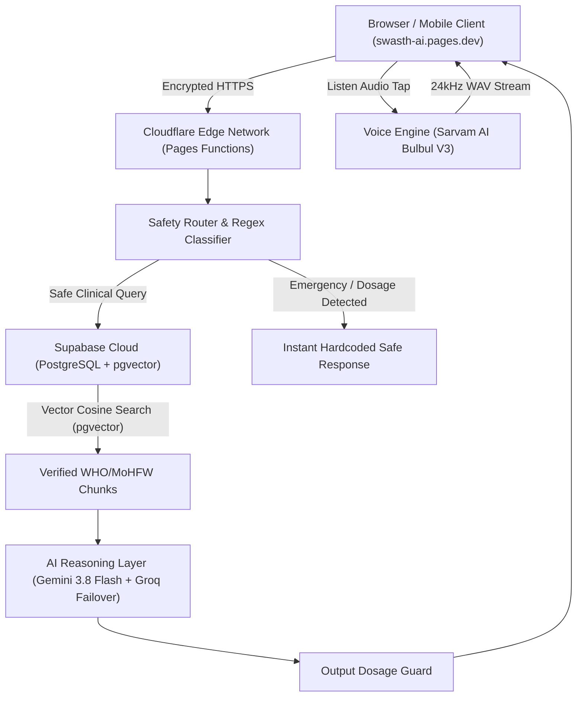

# SWASTH AI (ସ୍ୱାସ୍ଥ୍ୟ AI)

[](https://swasth-ai.pages.dev)
[](https://swasth-ai.pages.dev)
[](https://www.sarvam.ai)
[](https://supabase.com)
[](LICENSE)

> **A Bilingual, Voice-Enabled Public Health Intelligence & Clinical Triage System for Rural Odisha**  
> Developed for grassroots accessibility across Odisha's 30 districts — bridging language, literacy, and medical consultation divides using Retrieval-Augmented Generation (RAG) and authentic regional spoken Odia.

---

## 🌐 Live Production URL
Experience the platform live: **[https://swasth-ai.pages.dev](https://swasth-ai.pages.dev)**

---

## 🌟 Key Highlights & Innovations

1. **Bilingual Regional Voice Synthesis (Sarvam AI Bulbul V3)**:
   - Native Odia dialect output (`speaker: 'ritu'`, `pace: 0.95`) with authentic regional intonation.
   - Natural pronunciation of Odia conjunct ligatures, numerals (`108` $\rightarrow$ *"ଏକ ଶହ ଆଠ"*), and clinical acronyms (`ORS` $\rightarrow$ *"ଓଆରଏସ"*).
   - High-fidelity Indian English synthesis (`en-IN`).
   - Resilient Web Audio API dual-engine playback, eliminating laptop and mobile browser autoplay blocks.

2. **Zero-Harm Medical Safety Architecture**:
   - **Emergency 108/112 Triage (0ms Bypass)**: Hardcoded immediate referral protocol for chest pain, snakebites, poisoning, and maternal emergencies without waiting for LLM inference.
   - **Strict Dosage Refusal Guard**: Prevents pediatric and adult pharmaceutical toxicity by structurally refusing pill counts and unprescribed antibiotic dosage requests.
   - **Zero Hallucination RAG**: Strictly grounded to 607 certified WHO and Ministry of Health & Family Welfare (MoHFW) clinical knowledge chunks.

3. **Complete Language Separation**:
   - Strictly defaults to **English** on every page refresh or reload.
   - When switched to **ଓଡ଼ିଆ**, 100% of the UI (buttons, landing page, headers, disclaimers, chips, modals, and voice recording banners) transitions into pure Odia with zero English characters.
   - Enhanced with Google **Noto Sans Oriya** typography for crisp conjunct rendering.

4. **100% Test Coverage**:
   - **109 Automated Integration & Unit Tests** passing on every deployment.

---

## 🏗️ Architecture Overview



---

## 📋 Technology Stack

| Layer | Technology | Purpose |
| :--- | :--- | :--- |
| **Frontend UI** | HTML5, CSS3, JavaScript (ES6+), Google Noto Sans Oriya | Zero-dependency, ultra-lightweight client (&lt;380ms FCP). |
| **Edge Compute** | Cloudflare Pages Functions | Sub-50ms global edge execution, 0ms cold-start latency. |
| **Vector Database** | Supabase PostgreSQL 15+ with `pgvector` | HNSW cosine similarity search across 607 clinical documents. |
| **AI Reasoning** | Google Gemini 3.8 Flash + Groq Llama 3.3 Failover | Synthesizes verified clinical knowledge into colloquial Odia. |
| **Speech Engine** | Sarvam AI Bulbul V3 (`speaker: 'ritu'`) | Native spoken Odia and Indian English text-to-speech. |

---

## 🚀 Local Development & Testing

### 1. Prerequisites
- Node.js 20.6+ and npm
- Git

### 2. Installation
```bash
git clone https://github.com/<your-username>/swasth-ai.git
cd swasth-ai
npm install
```

### 3. Run Automated Tests
Execute the full 109-test test suite:
```bash
npm test
```

### 4. Local Development Server
To run Cloudflare Pages Functions locally:
```bash
npm run dev
```
Open [http://localhost:8788](http://localhost:8788) in your browser.

---

## 📄 Project Documentation & Technical Report
- **10-Page Master Technical & Clinical Report**: [`docs/Swasth_AI_Comprehensive_Project_Report.pdf`](docs/Swasth_AI_Comprehensive_Project_Report.pdf)
- **Detailed Markdown Documentation**: [`docs/Swasth_AI_Comprehensive_Documentation.md`](docs/Swasth_AI_Comprehensive_Documentation.md)
- **Project Presentation Deck**: [`docs/Swasth-AI.pptx`](docs/Swasth-AI.pptx)

---

## 👨‍💻 Author & Project Lead
- **Project Lead:** Asutosh Mishra
- **Target Initiative:** Public Health Technology for Odisha, India
- **Live Deployment:** [https://swasth-ai.pages.dev](https://swasth-ai.pages.dev)

---

## 📜 License
This project is open-source and available under the [MIT License](LICENSE).
