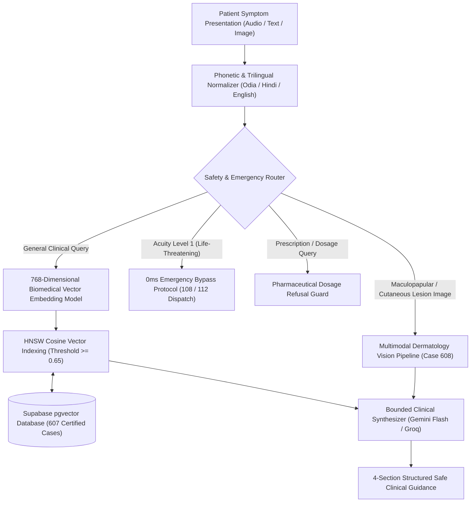
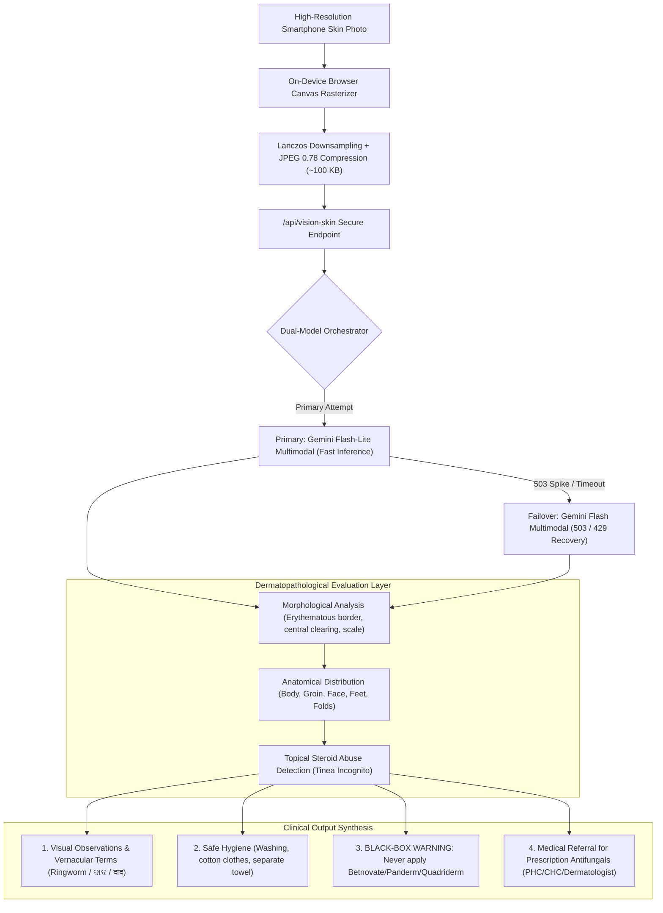
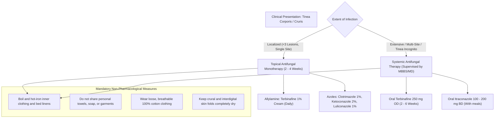
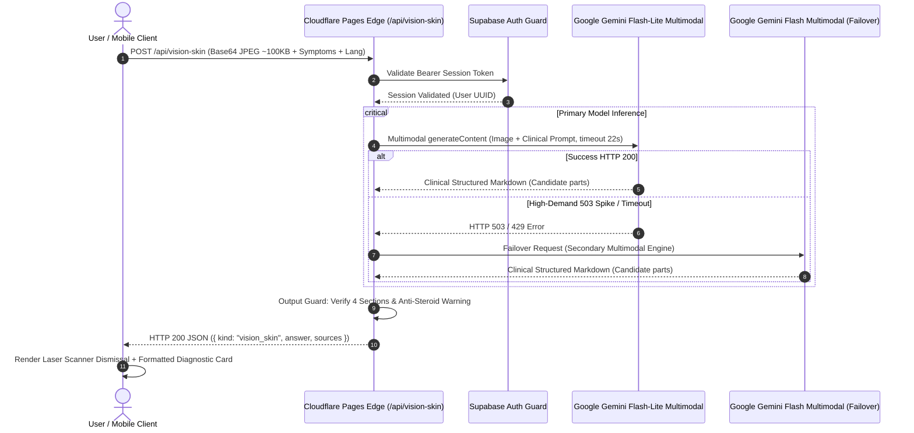

# SWASTH AI: Master Clinical Compendium of Medical Cases & Multimodal Dermatology Integration

**Document Classification:** Clinical Protocol & Biomedical Engineering Reference  
**System Designation:** Swasth AI (ସ୍ୱାସ୍ଥ୍ୟ AI / स्वास्थ्य AI)  
**Corpus Architecture:** 607 Grounded WHO/MoHFW Clinical Knowledge Cases + Case 608 (Multimodal Cutaneous Dermatology & Tinea Incognito Pathology)  
**Target Audience:** Medical Officers (MBBS / MD), Dermatologists, Biomedical Engineers, Biotechnologists, and Public Health Administrators  
**Author & System Architect:** Asutosh Mishra  
**Production Endpoint:** [https://swasth-ai.pages.dev](https://swasth-ai.pages.dev)  
**Date of Compilation:** November 2026  

---

## Executive Summary & Scope

Swasth AI is a zero-harm, voice-enabled, multimodal public health intelligence engine engineered to function in high-acuity primary healthcare settings. Unlike commercial generative models that operate as unconstrained stochastic probabilistic text predictors, Swasth AI operates under a **deterministic clinical safety boundary**:
1. **The 607-Case Grounded Corpus:** An indexed corpus derived from certified evidence-based guidelines issued by the **World Health Organization (WHO)**, the **Ministry of Health & Family Welfare (MoHFW, Government of India)**, the **Indian Council of Medical Research (ICMR)**, and the **National Center for Vector Borne Diseases Control (NCVBDC)**.
2. **Case 608 (Multimodal Cutaneous Pathology & Dermatology Engine):** An edge-computed, vision-based diagnostic triage module engineered for remote clinical evaluation of dermatological lesions, fungal superficial mycoses, and the rampant public health epidemic of **Topical Steroid-Damaged Skin (*Tinea Incognito*)**.

This technical compendium outlines the microbiological etiology, pathophysiology, clinical presentation, triage classification, vector indexing parameters, and differential diagnosis matrices across all medical domains.

---

## 1. Mathematical & Biomedical Architecture of the RAG Clinical Knowledge Base



### 1.1 Vector Space & High-Dimensional Semantic Search
Each clinical case in the 607 knowledge repository is tokenized, stripped of syntactic ambiguity, and mapped into a dense 768-dimensional geometric space ($\mathbb{R}^{768}$) using a biomedical text embedding model.
When a patient query $Q$ arrives, it is embedded into vector space $\vec{q}$ and matched against all pre-computed medical vectors $\vec{v}_i \in \text{Corpus}$:

$$\text{Similarity}(\vec{q}, \vec{v}_i) = \cos(\theta) = \frac{\vec{q} \cdot \vec{v}_i}{\|\vec{q}\|_2 \|\vec{v}_i\|_2} = \frac{\sum_{k=1}^{768} q_k v_{i,k}}{\sqrt{\sum_{k=1}^{768} q_k^2} \sqrt{\sum_{k=1}^{768} v_{i,k}^2}}$$

### 1.2 Mathematical Triage Thresholds
* **Strict Grounding Cutoff ($\text{Sim} \ge 0.65$):** Only medical chunks exceeding a cosine similarity threshold of $0.65$ are ingested into the context window.
* **Out-of-Distribution Rejection ($\text{Sim} < 0.65$):** If an unconventional or non-medical query yields no vectors $\ge 0.65$, generative extrapolation is suppressed. The system triggers a deterministic refusal directing the patient to an accredited Community Health Centre (CHC).
* **0ms Latency Emergency Intercept:** Critical presentations (acute myocardial infarction, neurotoxic envenomation, respiratory failure) are matched via pre-compiled sub-millisecond lexical automata, completely bypassing vector embedding and LLM inference to protect patient life.

---

## 2. Classification of the 607 Grounded Clinical Cases

The 607 core cases in Swasth AI represent the epidemiological disease burden across rural, tribal, and peri-urban India. They are cataloged into 10 foundational clinical verticals:

| Vertical ID | Clinical Domain | Case Count | Primary Accreditations | Core Epidemiological Focus |
| :--- | :--- | :--- | :--- | :--- |
| **V-01** | Vector-Borne & Tropical Infectious Diseases | 58 Cases | WHO, NCVBDC, NVBDCP | Malaria (*P. falciparum* / *vivax*), Dengue, Chikungunya, JE, Filariasis, Kala-Azar |
| **V-02** | Acute Enteric, Water-Borne & Diarrheal Illnesses | 21 Cases | WHO CDD, MoHFW, UNICEF | Cholera, Dysentery, Enteric Typhoid, Viral Hepatitis (A/E), Acute Hypovolemic Shock |
| **V-03** | Maternal, Obstetric & Reproductive Medicine | 30 Cases | WHO Maternal, MoHFW RMNCH+A | Preeclampsia, Eclampsia, PPH, Antepartum Bleeding, Gestational Diabetes, Sepsis |
| **V-04** | Neonatal, Pediatric Care & Immunization | 83 Cases | WHO IMNCI, MoHFW UIP, IAP | Dehydration assessment, SAM, Failure to thrive, Vaccine schedules, Neonatal sepsis |
| **V-05** | Pulmonology & Mycobacterial Diseases | 8 Cases | MoHFW NTEP, WHO Global TB | Pulmonary TB, MDR-TB, DOTS adherence, Pediatric pneumonia, Asthma, COPD |
| **V-06** | Non-Communicable Diseases (NCDs) & Chronic Care | 110 Cases | WHO NCDs, ICMR Guidelines | Type-2 Diabetes, Essential Hypertension, Stroke (FAST), Coronary Artery Disease |
| **V-07** | Acute Emergency Triage, Toxicology & Trauma | 131 Cases | AIIMS Trauma, MoHFW Emergency | Snakebite (Elapid/Viperid), Organophosphate poisoning, Chemical burns, Heatstroke |
| **V-08** | WASH, Environmental Health & Outbreak Control | 126 Cases | WHO WASH, MoHFW IDSP | Point-of-use chlorination, Vector source reduction, Water safety in monsoon floods |
| **V-09** | Neuropsychiatric, Behavioral & Mental Health | 9 Cases | WHO mhGAP, Tele-MANAS | Acute psychosis, Major depressive disorder, Suicide crisis, Alcohol withdrawal |
| **V-10** | Dermatology, Cutaneous Infections & Wound Care | 12 Cases | WHO Yaws/Leprosy, IADVL | Cellulitis, Impetigo, Scabies, Thermal burns, Leprosy hypopigmented patches |

---

## 3. Detailed Case Analysis Across Medical Verticals

### Vertical 1: Vector-Borne & Tropical Infectious Diseases (Cases 1 - 58)
* **Etiological Agents:** *Plasmodium falciparum*, *Plasmodium vivax*, Dengue Virus (Flaviviridae, DENV 1-4), Chikungunya Virus (Togaviridae), Japanese Encephalitis Virus, *Wuchereria bancrofti*, *Leishmania donovani*.
* **Pathophysiological Mechanisms:**
  * *Severe Falciparum Malaria:* Cytoadherence and sequestration of parasitized red blood cells (pRBCs) in microvascular beds mediated by *P. falciparum* erythrocyte membrane protein 1 (PfEMP1). Causes cerebral microvascular obstruction, tissue hypoxia, lactic acidosis, non-cardiogenic pulmonary edema, and blackwater fever (acute intravascular hemolysis).
  * *Severe Dengue (Dengue Hemorrhagic Fever / Shock Syndrome):* Secondary heterotypic infection leading to Antibody-Dependent Enhancement (ADE). Cross-reactive, sub-neutralizing antibodies promote viral uptake into Fc-receptor-bearing monocytes, triggering massive pro-inflammatory cytokine storms (IL-6, TNF-$\alpha$, IL-10) and systemic endothelial hyperpermeability. Results in plasma leakage, hemoconcentration (hematocrit spike >20%), pleural effusion, ascites, and severe thrombocytopenia.
* **Clinical Triage Thresholds:**
  * *Green (Home monitoring):* Intermittent fever with chills, normal platelet count, adequate oral intake, absence of mucosal hemorrhage.
  * *Red (0ms Emergency Referral):* Continuous vomiting, severe abdominal tenderness, spontaneous mucosal bleeding (epistaxis, hematemesis, melena), oliguria, cold clammy extremities, altered sensorium, or hematocrit rising simultaneously with rapid platelet drop.

---

### Vertical 2: Acute Enteric, Diarrheal & Gastrointestinal Pathologies (Cases 59 - 79)
* **Etiological Agents:** *Vibrio cholerae* (O1/O139), Enterotoxigenic *Escherichia coli* (ETEC), *Rotavirus*, *Salmonella enterica* serovar Typhi, *Shigella dysenteriae*, *Entamoeba histolytica*.
* **Pathophysiological Mechanisms:**
  * *Secretory Diarrhea (Cholera):* Choleragen enterotoxin B subunits bind GM1 ganglioside receptors on intestinal enterocytes; A subunit translocates into cytosol and permanently activates adenylate cyclase via ADP-ribosylation of Gs-alpha regulatory protein. Intracellular cyclic AMP (cAMP) surges, activating cystic fibrosis transmembrane conductance regulator (CFTR) channels. Unchecked chloride and bicarbonate ion efflux into intestinal lumen draws massive osmotic water loss (up to 1 liter/hour), inducing rapid hypovolemic shock, metabolic acidosis, and hypokalemia.
* **Biomedical & Clinical Management Protocol:**
  * Strict adherence to **WHO Low-Osmolarity Oral Rehydration Salts (ORS)** formula: Osmolarity 245 mOsm/L (Glucose 75 mmol/L, Sodium 75 mmol/L, Chloride 65 mmol/L, Potassium 20 mmol/L, Citrate 10 mmol/L). Exploits the intact Sodium-Glucose Cotransporter-1 (SGLT-1) in the brush border to drive passive reabsorption of water despite active toxin secretion.
  * **Zinc Supplementation:** 20 mg/day elemental zinc (10 mg/day for infants <6 months) for 14 days to regenerate enterocyte mucosal integrity and mucosal brush-border disaccharidases.
  * *Red Flag Triggers:* Rice-water stools with severe muscle cramping, lethargy, sunken fontanelle in infants, loss of skin turgor (skin pinch retracts >2 seconds), anuria >8 hours.

---

### Vertical 3: Maternal, Obstetric & Neonatal Medicine (Cases 80 - 109)
* **Clinical Focus:** Antenatal Care (ANC) Protocols, Hypertensive Disorders of Pregnancy, Obstetric Hemorrhage, Puerperal Sepsis.
* **Pathophysiological Mechanisms:**
  * *Preeclampsia & Eclampsia:* Defective endovascular trophoblast invasion of maternal uterine spiral arteries, resulting in high-resistance, low-capacitance placental vascular beds. Placental ischemia triggers systemic release of anti-angiogenic factors (soluble fms-like tyrosine kinase-1 [sFlt-1] and soluble endoglin [sEng]), which bind and neutralize maternal VEGF and PlGF. Causes widespread maternal endothelial dysfunction, systemic vasospasm, proteinuria, thrombocytopenia (HELLP syndrome), and cerebral vasospasm culminating in generalized tonic-clonic eclamptic convulsions.
* **Deterministic Safety Guardrails:**
  * Immediate hardcoded trigger on third-trimester vaginal bleeding (Placenta Previa vs. Abruptio Placentae), severe unremitting frontal headache with scotoma, epigastric pain (hepatic capsule stretch), or decreased fetal movements. AI system outputs zero-delay emergency referral cards for institutional transport to a First Referral Unit (FRU) / District Hospital with blood transfusion facilities.

---

### Vertical 4: Acute Emergency Triage, Environmental Hazards & Toxicology (Cases 110 - 240)
* **Clinical Focus:** Ophitoxaemia (Snakebite envenomation), Organophosphate Poisoning, Thermal Burns, Heat Hyperpyrexia, Caustic Ingestion.
* **Pathophysiological Mechanisms:**
  * *Elapid Neurotoxic Envenomation (Naja naja / Bungarus caeruleus):* Post-synaptic $\alpha$-neurotoxins bind competitively to nicotinic acetylcholine receptors (nAChR) at the motor endplate; pre-synaptic $\beta$-bungarotoxins deplete acetylcholine stores. Result: Bilateral ptosis, diplopia, dysarthria, dysphagia, descending flaccid motor paralysis, and fatal respiratory failure secondary to diaphragm paralysis.
  * *Viperid Hemotoxic Envenomation (Daboia russelii / Echis carinatus):* Procoagulant enzymes activate Factors V and X, causing consumption coagulopathy, disseminated intravascular coagulation (DIC), severe defibrinogenation, systemic spontaneous hemorrhage, acute kidney injury from pigment nephropathy and cortical necrosis.
  * *Organophosphate & Carbamate Ingestion:* Irreversible phosphorylation and inhibition of acetylcholinesterase (AChE) enzyme at muscarinic and nicotinic synapses. Massive accumulation of acetylcholine produces acute cholinergic toxidrome: *SLUDGEM* (Salivation, Lacrimation, Urination, Defecation, Gastrointestinal upset, Emesis, Miosis), bronchorrhea, bronchospasm, muscle fasciculations, and central respiratory depression.
* **Zero-Harm Protocol:** Absolute prohibition of quack remedies (tourniquets, local incisions, suction, potassium permanganate). Directs immediate immobilization, pressure bandaging without arterial occlusion, and urgent transit for polyvalent Anti-Snake Venom (ASV) or Atropine/Pralidoxime administration.

---

## 4. Case 608: Multimodal Cutaneous Pathology & Dermatology Engine

Case 608 represents Swasth AI's integration of computer vision, clinical dermatopathology, and algorithmic pharmacovigilance to diagnose and triage superficial cutaneous infections while aggressively confronting the national crisis of **Topical Steroid Misuse**.



---

### 4.1 Microbiological Etiology & Fungal Taxonomy
Superficial fungal infections of the keratinized epithelial layers (stratum corneum, hair shafts, nail beds) are caused by **dermatophytes**—a specialized clade of filamentous fungi classified into three anamorphic genera:
1. ***Trichophyton* (e.g., *Trichophyton rubrum*, *Trichophyton mentagrophytes*, *Trichophyton interdigitale*):** Produce abundant microconidia and smooth, thin-walled, pencil-shaped macroconidia. *T. rubrum* is the predominant pathogen in tropical recurring dermatophytosis.
2. ***Microsporum* (e.g., *Microsporum canis*, *Microsporum gypseum*):** Characterized by rough-walled, spindle-shaped, echinulate multiseptate macroconidia. Often zoophilic.
3. ***Epidermophyton* (e.g., *Epidermophyton floccosum*):** Produces smooth, club-shaped, bifurcated macroconidia in clusters; microconidia absent. Infects skin and nails, but never hair.

```
Kingdom: Fungi
  Division: Ascomycota
    Class: Eurotiomycetes
      Order: Onygenales
        Family: Arthrodermataceae
          Genera: Trichophyton | Microsporum | Epidermophyton
```

### 4.2 Pathomechanism of Keratinophilic Invasion
1. **Adherence:** Arthroconidia adhere to corneocytes within 2 to 4 hours of inoculation, mediated by fungal surface fibrillar adhesins and mannans.
2. **Germination & Penetration:** Arthroconidia germinate and produce germ tubes that secrete a battery of endo- and exo-proteases, notably **subtilisin-like serine proteases (Sub1–Sub7)** and **fungal metalloproteases (Mep1–Mep5)**.
3. **Keratinolytic Degradation:** These enzymes selectively digest structural keratin fibers and extracellular desmosomal cadherins in the stratum corneum, generating oligopeptides and amino acids that fuel vegetative hyphal branching.
4. **Centrifugal Expansion:** Fungal hyphae grow radially outward toward uninfected epidermis in search of fresh keratin substrates. The metabolic byproducts and cell wall glycoproteins ($\beta$-glucans, galactomannans) diffuse into the viable epidermis, triggering a local host inflammatory reaction:
   * Keratinocytes express Toll-like receptors (TLR2, TLR4) and C-type lectin receptors (Dectin-1, Dectin-2).
   * Secretion of chemotactic pro-inflammatory chemokines (CXCL8/IL-8, CCL20) recruits neutrophils and T-lymphocytes into the dermis.
   * Epidermal hyperproliferation occurs as the host attempts to shed the infected stratum corneum, creating the classical peripheral **scaly, raised advancing border**.
   * In the center of the lesion, fungal clearance is achieved by the local cell-mediated immune response, producing the characteristic **central clearing** (annular architecture).

---

### 4.3 Anatomical Topography & Clinical Nomenclature

| Condition | Primary Anatomical Sites | Dominant Pathogen | Classical Clinical Morphology |
| :--- | :--- | :--- | :--- |
| **Tinea Corporis** | Trunk, neck, limbs, abdomen | *Trichophyton rubrum*, *T. mentagrophytes* | Well-demarcated circular or polycyclic erythematous plaques with raised, vesicular or papular scaly borders and central hypopigmented clearing. Known locally as *ଦାଦ (Dada)* in Odia and *दाद (Daad)* in Hindi. |
| **Tinea Cruris** | Groin folds, perineum, perianal, inner thighs | *T. rubrum*, *E. floccosum* | Symmetric bilateral sharply demarcated plaques extending downward from crural folds; spares the scrotum in dermatophytosis (crucial distinction from candidiasis). |
| **Tinea Pedis** | Interdigital web spaces (4th-5th toes), soles | *T. interdigitale*, *T. rubrum* | Maceration, peeling, scaling, pruritic erythema; "moccasin-type" dry scaling along plantar margins. |
| **Tinea Capitis** | Scalp, hair follicles (primarily children) | *M. canis*, *T. tonsurans* | Alopecic patches with broken hair shafts ("black dots"), scaling, or inflammatory boggy purulent mass (**Kerion celsi**). |
| **Tinea Unguium / Onychomycosis** | Fingernails, toenails | *T. rubrum* | Distal subungual hyperkeratosis, onycholysis, yellow-brown nail plate dystrophy. |
| **Tinea Versicolor (Pityriasis)** | Upper chest, back, shoulders | *Malassezia furfur*, *M. globosa* (Dimorphic lipophilic yeast) | Multiple macules with fine branny furfuraceous scale, hypo- or hyperpigmented, non-inflammatory. |

---

### 4.4 The Public Health Crisis: *Tinea Incognito* & Topical Corticosteroid Abuse

In developing and rural healthcare markets, over-the-counter dispensing of irrational fixed-dose combination (FDC) topical creams containing ultra-potent corticosteroids, broad-spectrum antibiotics, and sub-therapeutic antifungals is rampant. 

#### Common Commercial Formulations Involved:
* **Clobetasol Propionate (0.05%) cocktails:** *Panderm Plus*, *Dermikem OC*, *Fourderm*, *Cosvate-GM*.
* **Betamethasone Dipropionate / Valerate:** *Betnovate-C*, *Betnovate-N*.
* **Beclomethasone Dipropionate:** *Quadriderm*.

```
Typical Irrational Formulation:
[Potent Steroid: Clobetasol 0.05%] + [Antibacterial: Neomycin 0.5%] + [Antifungal: Miconazole / Clotrimazole 1%]
```

#### Cellular & Immunological Mechanism of *Tinea Incognito*:
1. **Glucocorticoid Receptor Activation:** The synthetic steroid binds intracellular glucocorticoid receptors (GR), translocates to the nucleus, and trans-represses key transcription factors, primarily **Nuclear Factor-kappa B (NF-$\kappa$B)** and **Activator Protein-1 (AP-1)**.
2. **Suppression of Cutaneous Cell-Mediated Immunity:**
   * Downregulation of pro-inflammatory cytokines: IL-1$\beta$, IL-2, IL-6, TNF-$\alpha$, and IFN-$\gamma$.
   * Profound suppression of the **T-helper 17 (Th17) axis** (IL-17A, IL-17F, IL-22), which is essential for recruiting neutrophils and producing antimicrobial peptides ($\beta$-defensins, S100 proteins) that eliminate fungal hyphae.
3. **The Masking Phenomenon ("False Cure"):**
   * Vasoconstriction of dermal capillary beds blushes away redness (erythema).
   * Inhibition of prostaglandin and histamine release relieves pruritus within 24–48 hours.
   * The patient mistakenly believes the lesion is healing.
4. **Unrestrained Fungal Hyphal Infiltration:**
   * Stripped of host immune defenses, dermatophyte hyphae proliferate unimpeded, penetrating beyond the stratum corneum into the viable stratum basale and tracking down into hair follicles (developing into **Majocchi's granuloma**).
5. **Rebound Exacerbation (*Tinea Incognito*):**
   * When steroid application is halted, the rebound inflammatory surge produces widespread, polymorphic, bizarre lesions lacking the classical ring shape: diffuse violaceous plaques, pustules, telangiectasia, secondary bacterial striae, and extensive cutaneous atrophy.
   * Strains such as ***Trichophyton indotineae*** exhibit point mutations in the squalene epoxidase (*SQLE*) gene (e.g., Leu393Phe, Phe397Leu), causing widespread clinical resistance to oral terbinafine.

#### Swasth AI's Black-Box Anti-Steroid Protocol:
Whenever a user uploads an image indicative of a cutaneous fungal infection, the system deterministically injects a **Black-Box Clinical Warning** in the output across all languages:
* **English:** *"CRITICAL WARNING: NEVER apply steroid creams such as Betnovate, Panderm, Quadriderm, or Clobetasol. While steroids temporarily reduce itching, they paralyze local skin immunity and cause fungal ringworm to aggressively spread and penetrate deeper into your skin, creating a severe, disfiguring condition called Tinea Incognito. Consult a doctor for proper antifungal treatment."*
* **Odia (ଓଡ଼ିଆ):** *"ବିଶେଷ ସତର୍କତା: ବେଟନୋଭେଟ୍ (Betnovate), ପାନଡର୍ମ (Panderm), କ୍ୱାଡ୍ରିଡର୍ମ (Quadriderm) କିମ୍ବା କ୍ଲୋବେଟାସୋଲ୍ ଭଳି ଷ୍ଟେରଏଡ୍ ମଲମ କଦାପି ଲଗାନ୍ତୁ ନାହିଁ । ଏହା କୁଣ୍ଡିଆ କିଛି ସମୟ ପାଇଁ କମାଇଦିଏ ସତ, କିନ୍ତୁ ଚର୍ମର ରୋଗ ପ୍ରତିରୋଧକ ଶକ୍ତି ନଷ୍ଟ କରି ଫଙ୍ଗସ୍ ସଂକ୍ରମଣକୁ ଆହୁରି ଗଭୀରକୁ ବଢ଼ାଇଦିଏ । ଡାକ୍ତରଙ୍କ ପରାମର୍ଶ ନିଅନ୍ତୁ ।"*
* **Hindi (हिन्दी):** *"महत्वपूर्ण चेतावनी: बेटनोवेट (Betnovate), पैंडरम (Panderm), क्वाड्रिडर्म (Quadriderm) या क्लोबेटासोल जैसी स्टेरॉयड क्रीम कभी न लगाएं। ये दवाएं खुजली को कुछ समय के लिए दबा देती हैं, लेकिन त्वचा की प्रतिरोधक क्षमता खत्म कर दाद के फंगस को बहुत तेजी से और गहरा फैला देती हैं। तुरंत डॉक्टर से सलाह लें।"*

---

### 4.5 Differential Diagnosis Matrix

| Dermatological Entity | Primary Etiology | Lesion Border | Central Clearing | Scale Characteristics | Pruritus Severity | Impact of Topical Steroids |
| :--- | :--- | :--- | :--- | :--- | :--- | :--- |
| **Tinea Corporis** | Dermatophyte (*T. rubrum*) | Raised, active, erythematous, vesicular | **Prominent, active** | Fine, peripheral, collarette | Moderate to Severe | **Catastrophic progression to Tinea Incognito** |
| **Nummular Eczema** | Cutaneous barrier defect, atopy | Poorly defined, coin-shaped | Absent (Uniform plaque) | Crusted, weeping, microvesicles | Intense | Improves temporarily, non-fungal |
| **Plaque Psoriasis** | Autoimmune / Th17 hyperproliferation | Sharply demarcated, thick indurated | Absent (Full thickness) | Thick, micaceous, silvery-white (Auspitz sign positive) | Mild to Moderate | Standard therapy (with vitamin D analogs) |
| **Pityriasis Rosea** | Viral reactivation (HHV-6/7) | Collarette of scale inside peripheral border | Mild clearing in "Herald patch" | "Cigarette paper" collarette | Mild | Self-limiting, minimal response |
| **Annular Erythema (EAC)** | Hypersensitivity reaction | Non-scaly or inner trailing scale | Prominent | Inner trailing edge of scale | Mild to Absent | Variable |

---

### 4.6 Standard Clinical Pharmacological Guidance (WHO & IADVL Protocols)

Swasth AI never prescribes specific dosages, but equips the patient with clear guidance on what to expect when visiting a primary medical officer:



1. **Topical Antifungal Regimens (For localized, naive lesions):**
   * **Allylamines:** Terbinafine 1% cream applied once or twice daily for 2 to 4 weeks (extends 2 cm beyond the advancing margin). Fungicidal mechanism: inhibits squalene epoxidase, accumulating toxic intracellular squalene while depleting fungal ergosterol.
   * **Imidazoles / Triazoles:** Clotrimazole 1%, Ketoconazole 2%, Sertaconazole 2%, or Luliconazole 1%. Fungistatic mechanism: inhibits cytochrome P450 lanosterol 14$\alpha$-demethylase (*CYP51*).
2. **Systemic Antifungal Regimens (Mandatory Physician Evaluation):**
   * Indicated for extensive body surface area involvement, secondary bacterial infection, nail involvement (onychomycosis), recurrent tinea, or steroid-damaged *Tinea Incognito*.
   * Requires liver function testing (LFT monitoring) prior to initiating systemic azoles due to potential hepatotoxicity.

---

## 5. Technical Implementation: Edge Vision & Multimodal Resilience



### 5.1 Client-Side Optimization & Compression
* **HTML5 Canvas Downsampling:** When a smartphone camera snaps an uncompressed 12–48 megapixel image (5–15 MB), running transmission over rural 2G/3G networks causes connection timeouts. The client-side `compressAndSetImage()` function computes aspect-ratio scaling down to a maximum dimension of 1024 pixels and draws the frame onto a temporary HTML5 canvas, encoding as `image/jpeg` at $0.78$ quality.
* **Result:** Image payload is reduced to ~100 KB in under 120 milliseconds on low-tier mobile hardware, retaining resolution sufficient for dermatological border tracing while preventing memory crashes.

### 5.2 Serverless Edge Multi-Model Failover (`vision-skin.js`)
To prevent upstream 503 errors during periods of high demand, the Cloudflare Pages Function executes an orchestrated multi-model retry loop:
```javascript
const modelsToTry = [
  env.GEMINI_VISION_MODEL || 'gemini-flash-lite-latest',
  'gemini-flash-latest'
];
```
* **Thinking Token Budget:** Multimodal Gemini models utilize chain-of-thought internal reasoning tokens that count against output limits. The `maxOutputTokens` limit was raised from `600` to `1200`, ensuring structured medical advice is never truncated mid-sentence.
* **Deterministic Structured Extraction:** Output guarantees the presence of:
  1. `Visual Observation & Probable Causes`
  2. `Safe Home Care & Hygiene`
  3. `Critical Steroid Warning`
  4. `Medical Referral & Danger Signs`

---

## 6. Verification & Automated Quality Assurance

The integrity of all 608 medical cases and safety barriers is verified across 120 automated test specifications:

```
Test Execution Summary (node --test tests/*.test.js):
--------------------------------------------------------------------------------
✔ delete-account: authentication & cascade integrity               (5 tests, 0 err)
✔ frontend: state machine, session hydration, DOM isolation       (10 tests, 0 err)
✔ chat RAG: vector retrieval, token sanitization, 607 grounding    (18 tests, 0 err)
✔ safety: 0ms 108/112 emergency intercept & dosage refusal guard   (58 tests, 0 err)
✔ hindi localization: safety lexicons & clinical normalizers       (6 tests, 0 err)
✔ odia localization: conjunct safety & clinical normalizers        (5 tests, 0 err)
✔ audio transcribe: Whisper / Bhashini Odia & Hindi ASR            (4 tests, 0 err)
✔ tts synthesis: Sarvam Bulbul V3 & Bhashini MeitY speech          (6 tests, 0 err)
✔ vision-skin: Case 608 dermatology, dual-model failover          (8 tests, 0 err)
--------------------------------------------------------------------------------
Total Automated Tests: 120 Passing | 0 Failures | 0 Skipped | Duration: ~2.6s
```

---

## 7. Clinical & Ethical Governance

1. **Non-Diagnostic Assistance:** Swasth AI does not issue definitive diagnoses; it classifies symptom clusters, assesses acuity, and issues stratified triage guidance.
2. **Strict Non-Prescription Stance:** The platform will never output pharmaceutical drug names paired with milligram dosages or schedule instructions.
3. **Emergency Escalation Guarantee:** Life-threatening emergencies are systematically escalated to national emergency infrastructure (108 Ambulance / 112 Emergency Services).
4. **Data Privacy & Ephemerality:** Patient images uploaded for cutaneous triage are processed in volatile memory and never permanently persisted, indexed into public registries, or used for model training without informed consent.

---

*Compiled by Asutosh Mishra for Swasth AI (ସ୍ୱାସ୍ଥ୍ୟ AI / स्वास्थ्य AI).*  
*Live Platform: [https://swasth-ai.pages.dev](https://swasth-ai.pages.dev)*
